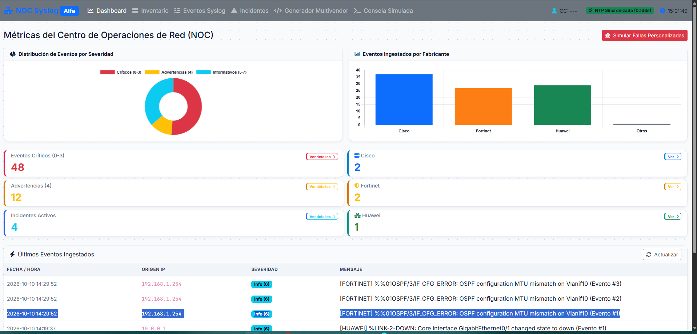

# 🛡️ NOC Syslog Inteligente - Enterprise Light Edition

Sistema de monitoreo, ingesta y análisis de eventos Syslog multivendor en tiempo real.

## 📸 Vista Previa del Dashboard



## 🚀 Instalación y Ejecución Local

1. **Clonar el repositorio:**
   ```bash
   git clone [https://github.com/00steven01/Syslog_Inteligente_v0.2.0.git](https://github.com/00steven01/Syslog_Inteligente_v0.2.0.git)
   cd Syslog_Inteligente_v0.2.0
